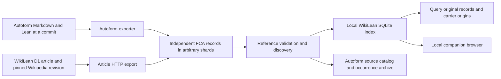

# Autoform, companion annotations, and WikiLean

This page documents the current local conversion bridge. The intended next
architecture is [native WikiLean records and independent Autoform articles with
companion attachments](COMPANION-NATIVE.plan.md). The exporters described below
are transitional compatibility tools, not the target WikiLean data model.

For one installed environment, a repeatable refresh, a local browser, and the return
path into Autoform's source catalog, use [the local workspace](COMPANION-WORKSPACE.md).

The shared exchange unit is one FCA informal–formal association. Autoform emits
that unit from committed blueprint articles; WikiLean emits it from a consistent
D1 article snapshot and ingests it into a local SQLite index. Authors can arrange
shards however they want. The reference schema remains in Formal Companion
Annotations; neither application maintains a copy or adds mandatory core fields.



The unpublished single-annotation schema has no version field. Only `source` and
`target` are required. This integration uses the reference Python package's
**2.0.0a2** development build; that package version is separate from the annotation
format. No manifest, collection identity, or required application profile is added.

## Use an existing Autoform project

Install the Autoform integration checkout using its normal `uv sync` workflow.
Install the reviewed FCA checkout or wheel in a Python 3.12 environment, following
[the import guide](COMPANION-IMPORT.md#install-the-reference-validator).
From the WikiLean checkout, with `autoform` and the FCA environment available:

```sh
autoform export-annotations /absolute/path/to/consumer \
  --repo https://github.com/owner/consumer --commit FULL_COMMIT_SHA \
  --output /absolute/path/to/new-export --json

python -m brain.ingest.companion ingest /absolute/path/to/new-export/annotations \
  --source-key my-project --output /absolute/path/to/new-index

python -m brain.ingest.companion query --data-dir /absolute/path/to/new-index
python -m brain.ingest.companion query --data-dir /absolute/path/to/new-index \
  --target 'https://github.com/owner/consumer/blob/FULL_COMMIT_SHA/Consumer.lean#L2'
```

Use the actual full commit and formal target returned by the exporter. It verifies
the captured Markdown and Lean bytes against that local commit. Its GitHub URLs
become remotely readable only when that repository and commit are available there.
The whole Markdown article is the informal resource, represented as `generic`.
Multiple named local declarations produce separate links. Authored assertions and
derived Autoform status are optional `org.autoform` metadata, never proof evidence.

Autoform's `report.json` lives beside the `annotations/` scan root. Exit 1 means
the report lists omissions; exit 2 means export failed. External Mathlib references
currently remain omissions until a pinned library resolver exists. No new Autoform
planning or proving workflow is needed for export.

## Export a WikiLean article

The Worker adds `GET /api/article/:slug/companion.json`. After deploying this branch,
a caller can save its default JSON array as a shard and feed it to the same import
command. This endpoint is not assumed to be deployed on the public site yet.

The endpoint reads D1 once, pins the informal URL to `articles.revid`, and uses the
article's explicit Mathlib module and declaration for its existing documentation
link. The documentation target is mutable and marked `target_pinned: false`.
It never uses `latest_revid` to move an existing anchor to another revision.

Each native anchor produces its own record. WikiLean anchor normalization and
inclusive ranges do not equal FCA HTML quotation semantics; the adapter preserves
the known public v3 anchor fields under `location.profile: urn:wikilean:anchor:v3`
in `generic` mode, with `resolution: not_attempted`. An empty locator stays explicit
and unresolved. Missing or malformed anchors are reported as omissions. Consumers
that do not understand this profile can retain the record without pretending to
highlight its text.

Only `formalized` and `partial` annotations with explicit formal destinations can
produce links. `not_formalized` entries are reported as having no target. Rejected
and pending entries are excluded, including from diagnostics and even for bots.
Editor identities, review metadata, provenance, notes, and unknown private fields
are not exported. A public status still does not establish equivalence or a proof.

The response has `X-Companion-Annotations` and `X-Companion-Omissions` counts.
`?report=1` returns `{annotations, diagnostics}` for inspection; that report is not
a shard. Unknown articles return 404; articles without a pinned revision return
409. An empty successful export is `[]`. Responses are not cached across versions.

## Run the complete offline integration check

Install `wiki/` dependencies with `npm ci` under Node 22. Install the Autoform
integration checkout and the reference FCA package as above, then run:

```sh
python scripts/check-companion-integration.py \
  --autoform /absolute/path/to/autoform/.venv/bin/autoform \
  --node /absolute/path/to/node22 \
  --output /absolute/path/to/new-demo
```

This creates an independent synthetic Git consumer and calls the installed Autoform
CLI. It also exercises the real WikiLean HTTP route against the hermetic SQLite D1
fixture. Both exports pass through the reference checker and shard discovery, then
the real Brain SQLite builder and indexed reader. The check recovers 12 records:
two Autoform links, five WikiLean links, and five records covering all four source
modes, duplicate IDs, relative references, opaque extensions, and a large integer.
It verifies complete decoded-record recovery and queries by source and target.
The generated artifacts and `integration-result.json` remain under the output
directory for inspection. The GitHub fixture URLs are synthetic, not published
resources. This test does not run Lean or establish mathematical correspondence.

## Current boundary

The local index uses WikiLean's existing Brain storage implementation. It preserves
all annotations, carrier bases, JSON pointers, and JSONL lines, including duplicate
IDs and content. It accepts PDF, LaTeX, HTML, and generic sources without an Autoform
extension. A bad selected shard rejects the entire import before publication.

This is a working local interchange path. It does not write live D1 articles or
admit arbitrary URI endpoints into the public Brain graph. That graph requires
semantic identities and reviewed source evidence. See
[the storage and publication boundary](COMPANION-IMPORT.md#storage-and-application-boundary).
The local workspace now includes a companion viewer and FCA-to-Autoform source
catalog import. Live admission, pinned external-library resolution, and automatic
roadmap authorship remain separate concerns. The core schema needs no expansion
for these adapters.
