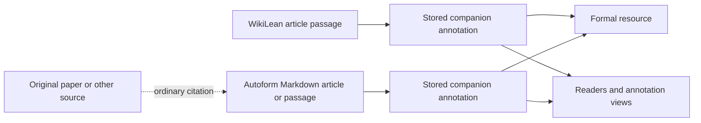

# Native companion annotations in WikiLean and Autoform

**Date:** 2026-10-06.
**Status:** Implemented on the local integration branches, pending deployment.
WikiLean's new articles use native records; existing databases require the explicit
copied-SQLite migration. Autoform articles remain informal sources with separately
stored annotations. See [the local workspace guide](COMPANION-WORKSPACE.md) and
[the native lifecycle runbook](COMPANION-NATIVE.md) for the implemented interfaces.
The design below records the rationale; no production migration has been run.

## Decision and scope

WikiLean should store, edit, render and serve actual companion annotations as its
formal–informal link representation. A read endpoint should select authorized
stored annotations and serialize them, without reconstructing targets from
`mathlib.decl/module` or locations from a separate authoritative anchor format.
D1 remains the canonical application database. SQLite indexing, HTTP responses
and shard files are consumers or carriers of the same records.

An Autoform Markdown wiki article should remain an independent informal resource.
Separate companion annotations associate the article, or a selected part of it,
with formal resources. One article can have zero, one or many associations. A
formal declaration can have associations from several articles and other sources.
The article is not itself a companion annotation.

The core schema remains unversioned and unchanged: one `source`, one `target`,
optional `location`, `id`, `$schema` and `extensions`. There is no companion-wide
manifest, required directory layout, review policy or proof scheduler in it.

A citation from an Autoform article to a paper is a separate relationship. It does
not automatically make the article's formal association an association with the
paper. Imported annotations retain their original informal source.

## WikiLean data ownership

The current `Annotation` combines several concepts. The proposed application
model separates their authority; these are WikiLean storage choices, not new Literature Links
schemas or mandatory tables for other applications.

| Data | Authority and responsibility |
| --- | --- |
| Companion annotation | Complete portable link, including its source, location, target and retained extensions. It is the sole editable authority for that association. |
| Review/coverage item | Existing item identity, label, coverage status, notes, provenance, flags and a list of associated record identities. One item may have several links. |
| Source occurrence without a target | Application work item with its source and location; it has not yet become a companion link. Unresolved target candidates remain application evidence. |
| Revision and moderation history | Authenticated changes, proposal decisions, rejection tombstones, record/group identity mappings and the source revision used by that snapshot. |

Targetless source occurrences remain separate application work items. Do not make `target` optional or invent a placeholder formal URI to
fit an unformalized statement into the link schema.

Keep the existing review-item IDs through migration. Several old anchors can
become separate Literature Links records linked to the same review item, with persistent
application record keys. Core `id` remains optional and is not a global deduplication
key. Duplicate imported IDs and duplicate associations must not silently merge.
Coverage counts continue to count review items, not the number of their spans.

Once linked, source/location/target values are read from the actual Literature Links records.
Legacy `mathlib` and `anchor(s)` values must not remain a second editable authority.
An editor can still display declaration names and familiar anchor controls by
interpreting the native record. Unknown extensions and unsupported locations must
survive an edit that does not explicitly replace them.

Existing WikiLean selectors have different semantics from the Literature Links HTML quotation
selectors. They are stored as `html` sources whose location carries the WikiLean anchor
profile, which the resolver consumes directly. Native storage
does not require pretending that every existing selector is an HTML quote.

Publicly readable records must contain only intentionally shareable data. Private
moderation notes and actor details belong in application records. The public
endpoint may filter entire records by visibility, but must not need a lossy field
projection to turn private application objects into portable annotations.
Define public-record, editor-state and revision-diff serializers explicitly:
the present article API and public history pages have broader field exposure
than the companion endpoint. Changing only that endpoint cannot establish the
new privacy boundary. Derive ownership and provenance from authenticated actors
and stored state, never imported extensions or a client's claimed provenance.
Relative references need a durable carrier/base URI in storage; the database
filename must never silently become that base.

## Why the current exporter cannot be the migration

`wiki/src/companion.ts` deliberately filters rejected/pending records, omits
targetless or unresolved entries, selects public metadata and splits anchors.
That is suitable for its present interchange bridge, but not a lossless migration.
Migration must account for every original item, including contradictions,
tombstones, pending changes, unknown fields and missing resource information.

The read-only local cache inspection found targetless items, multi-anchor items,
and items whose status and formal target disagree. These caches are not live D1
authority and cannot be used to reseed the application. A migration rehearsal must
report these cases separately instead of silently dropping or repairing them.

The code audit identified these coupled changes:

| Surface | Current responsibility and native-format work |
| --- | --- |
| `wiki/src/db/schema.ts` | Current article and revision annotation blobs; add explicit snapshot/source context and storage for native records plus work items. |
| `wiki/src/index.ts` | Create, save, proposal decisions, endorse, revert and rollback all write the current format. They must move together with optimistic concurrency and atomic revision/event updates. |
| `wiki/src/validation.ts` | IDs, human-edit preservation, item diffs and attribution need to account for associated native records. |
| `wiki/src/engine/types.ts`, `wrap.ts`, `page.ts` | Render the native sources and locations, while obtaining coverage and review state from application items. |
| `wiki/assets/editor.js` | Stop rebuilding legacy `mathlib` and `anchor` objects as link authority; edit native records and preserve unfamiliar values. |
| `site/batch_annotate.py`, `moderate.py`, `update_from_upstream.py`, `render.py` | Migrate the pipeline and Python renderer with the Worker and editor; preserve TypeScript/Python behavior parity. |

Article-level JSON snapshots can initially hold work items and native Literature Links records
together; native adoption does not itself require separate SQL link tables.
Centralize validation and mutation assembly across the existing write paths, and
retire or guard direct legacy writers such as backfill and seed utilities.

## Revision and migration invariants

- D1 stays canonical. Rehearsal uses an explicitly selected snapshot; migration
  never rebuilds live annotations from disk caches.
- Each mutation commits article content, native links, review items, revision,
  event history and moderation bookkeeping under the existing concurrency guard.
  Revision counters remain application state, not fields of a Literature Links annotation.
- Preserve original snapshots and a deterministic old-item-to-new-record mapping.
  Every item is migrated or explicitly retained for resolution; no omissions are
  treated as successful migration.
- `articles.revid` still advances only with a coherent re-anchored payload. A native
  source pinned to a Wikipedia revision must agree with the resource actually used
  to resolve its location. Verify every active occurrence, not merely one span of
  a multi-span review item.
- Changing a source URI to a new revision changes the annotation. It must use an
  authorized, audited update with truthful attribution. Do not bypass the existing
  human-preservation guard or leave AI-changed content labeled as human.
- Old revisions currently lack their own source-revision field. Do not guess a
  historical pin during migration or revert. Recover verified context where
  available; retain unresolved history with an explicit diagnostic and avoid
  treating it as a currently resolved native annotation.
- Keep rejection tombstones and pending proposals, but prevent them from leaking
  through public reads. Stale proposals must be rebased deliberately or rejected.
- Test and invalidate render caches when their input contract changes. Readability
  of a link is not evidence that the formalization has been verified.

## Autoform: article attachments before workflow replacement

The current exporter already points each record's `source.uri` at a committed
Markdown article. Keeping articles independent therefore does not itself require
rewriting the roadmap. The gaps are attachment consumption and association
ownership:

1. Store authored Literature Links associations in selected shard roots; retain originals and
   carrier origins when importing other sources.
2. Build an attachment index that maps explicit informal resource identities to
   existing articles. A verified `article_id` mapping can survive renames; titles
   or filenames alone are not mathematical identity. Stable article identity does
   not validate a selector against revised prose. Retain its original revision/base
   and identify historical or stale attachments; never silently retarget them to
   the current article content.
3. Render attached links on the original article. Generated numbered evidence
   pages may remain an optional inspection view, never replacement source articles.
4. Retain and serve the actual Literature Links records. Import followed by export must preserve
   unknown values and occurrences; relocation must retain or deliberately rewrite
   relative-reference bases.
5. Keep arbitrary imported associations separate from Autoform's checked execution
   targets, proof assertions, dependencies and review state. A link alone cannot
   make a node ready or verified.

During the transition, existing `lean:` workflow targets and directly authored Literature Links
records need explicit ownership. `lean:` is an execution contract, so sharing an
endpoint with a Literature Links association does not make that execution metadata redundant.
Derived compatibility links must not be editable independently of their owner.
If the same association becomes natively authored in Literature Links, retire duplicate
association authoring in that change, while preserving the separate checked
execution contract until an explicit workflow migration replaces it.

Removing `lean:` and other execution metadata from Markdown is a larger, separate
Autoform workflow refactor. Its effects reach status, work selection, skeletons,
assumption checks and review—not just companion records. It is not necessary to
adopt independent articles with native companion attachments.

Use explicit source representations. Markdown may use `generic` mode and an
application block locator; a rendered HTML page can use HTML mode when that page
is the selected source. Autoform embeds some leaf articles in chapter pages, so
HTML URLs and fragments must come from the renderer's actual mapping, not an
assumed `.md` to `.html` substitution. A presentation view must not silently
replace the resource identified in the annotation.

## Implementation sequence and completion criteria

1. **Lossless migration rehearsal:** inventory an authorized snapshot, preserve
   originals, classify unresolved cases, and prove record/item identity mappings.
2. **Native WikiLean model and consumers:** validate shared Literature Links records, render
   them and implement review-item relationships without duplicating link authority.
3. **Coordinated writes and history:** migrate editor, pipeline, proposals, counts,
   revision/revert handling and provenance guards; test concurrent and failed writes.
4. **Local cutover rehearsal:** migrate a copied database, exercise all write paths,
   and compare visible spans, coverage, review history and complete portable values.
   Rehearse rollback after additional native edits: use a reader-compatible release
   or an explicit reverse migration, not restoration of a snapshot that loses edits.
5. **Retire recurring conversion:** WikiLean reads return already-stored annotations;
   the legacy converter is used only for explicit migration/compatibility.
6. **Autoform attachments:** add native discovery, identity mapping and article
   presentation with the retained-record round-trip guarantees above.

Completion means the same native association survives create/edit/read/render,
review, re-anchor and revert—not merely that an exporter produces valid JSON.
Validation must include targetless work, duplicate occurrences, unfamiliar
extensions, multi-anchor partial failures, rejected items, pending/stale proposals,
source-revision changes, old history and concurrent saves. All four Literature Links modes must
round-trip even when a particular UI cannot resolve them.

This plan authorizes no deployment or live migration. The existing local bridge
remains usable while these coupled changes are developed and reviewed.
